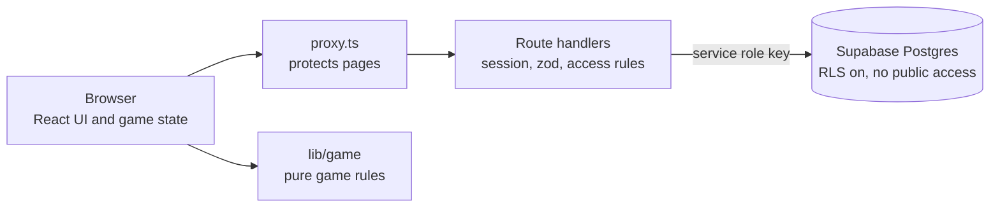
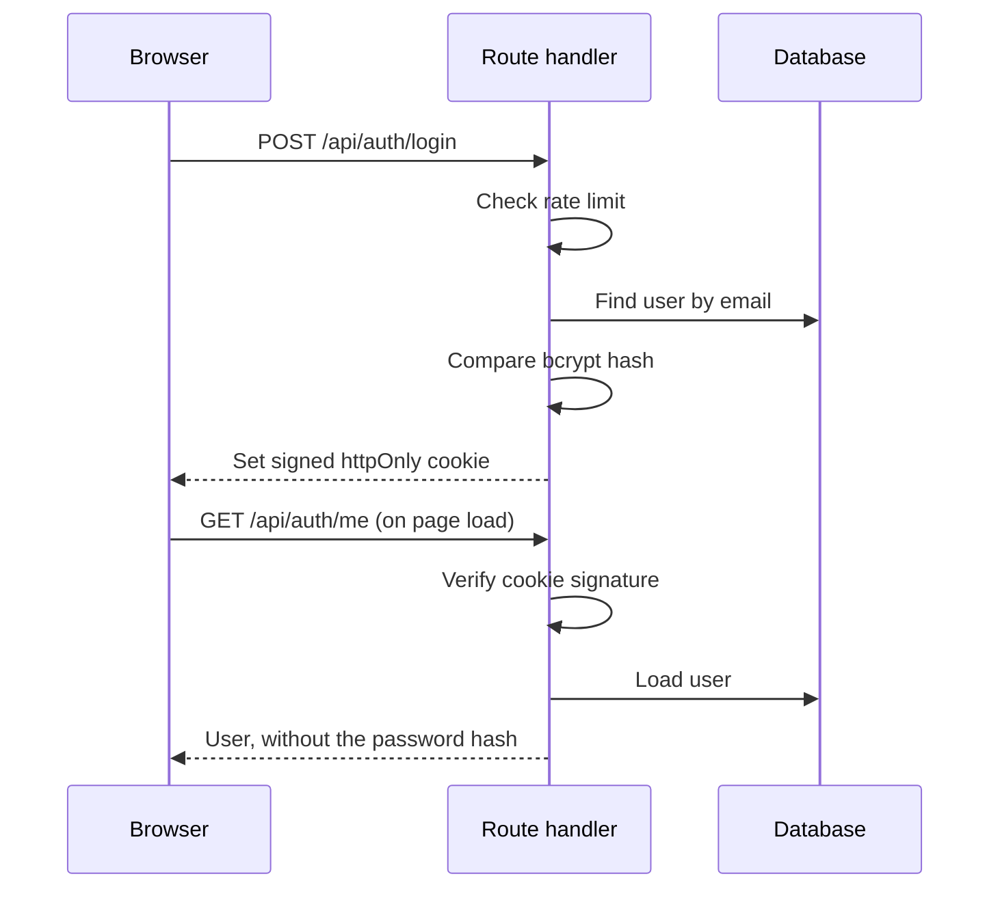

# Connect Five: Python Edition

[](https://github.com/nickteo123456/five-in-a-row/actions/workflows/ci.yml)

An educational take on Five-in-a-Row (Gomoku). Every move starts with a Python question: answer it correctly to place your piece. Students see which topics they need to practise, and teachers see where the whole class struggles.


## How to play

1. Each turn starts with a Python question. Harder questions earn more points (10, 15 or 20).
2. Answer correctly and you place your piece. Answer wrong and your turn ends, but you see the explanation.
3. The first player with five or more in a row, in any direction, wins.

## Features

**Ways to play**

- Against the computer, or two players on one screen
- Two players on a real board, with the app running the quiz
- Online with a lobby code or QR code, including rematches and reconnecting after a refresh
- Guest mode for local games, with no account needed

**Learning**

- Choose a difficulty and topic before a local game
- Missed questions come back a few turns later
- Accuracy by topic, a review list of missed questions, and achievements
- Teachers see class accuracy by topic and the hardest questions, and manage the question bank

**Experience**

- English and Chinese interface
- Works on phones: tap to select and tap to confirm, with board zoom
- Keyboard and screen reader support on the board
- Sound and vibration, optional answer timer, and a global leaderboard
- Installable as a PWA

## Tech stack

| Area      | Technology                                                     |
| --------- | -------------------------------------------------------------- |
| Framework | Next.js 16 (App Router), React 19, TypeScript                  |
| Database  | Supabase (PostgreSQL)                                          |
| Styling   | Tailwind CSS 4, Radix UI primitives, lucide icons              |
| Auth      | Own users table, bcrypt, signed httpOnly session cookie (jose) |
| Quality   | zod, ESLint, Prettier, Vitest, GitHub Actions                  |

## Architecture



The browser never talks to Supabase. Every read and write goes through a route handler, which checks the session first. Game rules are pure functions in `lib/game`, with no React, so they are easy to test.

Online games are a shared row in `game_lobbies`. Each player polls it every 1.5 seconds and sends moves with `PATCH`. When a lobby first becomes `completed`, the server records the result for both players, exactly once.

### Login and session flow



## Security

- **Sessions:** a signed JWT (HS256, 7 days) in an httpOnly, SameSite=Lax cookie that is Secure in production. It holds only the user id and role.
- **Roles:** decided on the server. Registering always creates a student; the teacher account comes from `npm run create-teacher`. `localStorage` holds guest data and preferences, never permissions.
- **Authorization:** each route checks the session with `requireUser` or `requireRole`. User ids always come from the session, never from the request.
- **Database:** RLS is on for every table with no policies, and the `anon` and `authenticated` roles have no access. Only the server's service role key gets in.
- **Validation:** request bodies are checked with zod. Lobby updates accept a fixed list of fields, from lobby members only.
- **Rate limits:** login, registration and password reset are limited, with counters in the database.
- **Passwords:** bcrypt hashes, never returned to clients. Reset links are single use, expire in 1 hour, and only their hash is stored.

**Known limits:** quiz grading and move checks run in the browser, so a determined player can fake their own score or moves. Answers saved for learning stats are graded on the server. Moving all game rules to the server would close this gap.

## Getting started

### Prerequisites

- Node.js 22.12 or newer (the app itself runs on 20.9 and up; the test tools need 22.12)
- A Supabase project (optional: without one the app runs in dev mode, with data kept in memory)

### 1. Install

```bash
npm install
cp .env.example .env.local
```

### 2. Configure environment variables

| Variable                    | Required             | Description                                                               |
| --------------------------- | -------------------- | ------------------------------------------------------------------------- |
| `NEXT_PUBLIC_SUPABASE_URL`  | For Supabase         | Supabase project URL. Leave empty for dev mode.                           |
| `SUPABASE_SERVICE_ROLE_KEY` | For Supabase         | Server-only key. Never expose it to the browser.                          |
| `SESSION_SECRET`            | In production        | At least 32 characters. Generate with `openssl rand -base64 32`.          |
| `APP_URL`                   | In production        | Public site address, used in reset links and social previews.             |
| `RESEND_API_KEY`            | For password reset   | [Resend](https://resend.com) API key. Without it, no reset email is sent. |
| `EMAIL_FROM`                | For password reset   | Sender, such as `Connect Five <noreply@your-domain.com>`.                 |
| `TEACHER_EMAIL`             | For `create-teacher` | Teacher email. Also seeds the teacher in dev mode.                        |
| `TEACHER_PASSWORD`          | For `create-teacher` | At least 12 characters.                                                   |
| `TEACHER_NAME`              | No                   | Display name (defaults to `Teacher`).                                     |

### 3. Set up the database

In the Supabase SQL editor, run every file in `supabase/migrations/` in number order, then `supabase/seed.sql`. Every file can safely run again, including on an existing database.

> `0008_row_level_security.sql` is what keeps your data private: until it runs, the public anon key may be able to read `users`, including password hashes.

### 4. Create the teacher account

```bash
npm run create-teacher
```

This hashes the password and upserts on email, so you can run it again to change the password. Dev mode doesn't need it.

### 5. Run

```bash
npm run dev
```

Open [http://localhost:3000](http://localhost:3000).

## Scripts

| Script                   | Description                                      |
| ------------------------ | ------------------------------------------------ |
| `npm run dev`            | Start the development server                     |
| `npm run build`          | Production build (fails on type errors)          |
| `npm start`              | Serve the production build                       |
| `npm run lint`           | Run ESLint                                       |
| `npm run format`         | Format with Prettier                             |
| `npm run typecheck`      | Type-check with `tsc --noEmit`                   |
| `npm test`               | Run the Vitest suite                             |
| `npm run test:coverage`  | Run tests with a coverage report                 |
| `npm run create-teacher` | Create or update the teacher account in Supabase |

## Testing

`npm test` runs the Vitest suite in `tests/`. It covers the game rules (wins in every direction, overlines, board edges, full boards), the computer opponent, question queues, sessions (expired, tampered and unsigned tokens), validation, password reset, learning summaries, and the access rules of the API routes.

Tests always run in dev mode, so they never touch a real database. Queries that only run against Supabase aren't covered by this suite.

## Project structure

```
app/
  api/                  Route handlers (see the table below)
  lobby/[code]/         Online lobby
  leaderboard/          Global leaderboard
  login/, register/, forgot-password/, reset-password/
  student/dashboard/    Stats, topic progress, review list, achievements
  teacher/dashboard/    Students, history, class insights, questions
components/
  game-provider.tsx     Game state and lobby syncing
  game-dashboard.tsx    Chooses the menu, game or results screen
  game-board.tsx, quiz-interface.tsx, game-results.tsx, home-menu.tsx, ...
  teacher/, dashboard/  Dashboard pieces
  ui/                   Shared UI primitives
hooks/                  Data loading hooks
lib/
  game/                 Pure game rules: board, computer player, questions, scoring
  i18n/                 English and Chinese text
  session.ts            Session cookie, requireUser, requireRole
  validation.ts         zod schemas
  lobbies.ts            Lobby data access
  match-results.ts      Saves results when an online game ends
  learning.ts           Answer records and progress summaries
  rate-limit.ts         Login and registration limits
proxy.ts                Protects /teacher, /student and /leaderboard
public/                 Icons, service worker, offline page
scripts/                create-teacher.js
supabase/               SQL migrations and seed questions
tests/                  Vitest suite
types/                  Shared types
```

## API routes

Access levels: **public** (anyone), **user** (logged in), **member** (logged in and in that lobby), **teacher** (teacher role).

| Method             | Route                        | Access  | Description                                              |
| ------------------ | ---------------------------- | ------- | -------------------------------------------------------- |
| `POST`             | `/api/auth/register`         | public  | Register a student and start a session                   |
| `POST`             | `/api/auth/login`            | public  | Log in and start a session                               |
| `POST`             | `/api/auth/logout`           | public  | Clear the session                                        |
| `POST`             | `/api/auth/forgot-password`  | public  | Email a reset link                                       |
| `POST`             | `/api/auth/reset-password`   | public  | Set a new password with a reset token                    |
| `GET`              | `/api/auth/me`               | user    | Get the current user                                     |
| `GET`              | `/api/questions`             | public  | List questions (`?random=true&count=N` for a random set) |
| `POST`             | `/api/questions`             | teacher | Create a question                                        |
| `PUT` / `DELETE`   | `/api/questions/[id]`        | teacher | Update or delete a question                              |
| `POST`             | `/api/quiz/attempts`         | user    | Record an answer, graded on the server                   |
| `POST`             | `/api/lobby/create`          | user    | Create an online lobby                                   |
| `POST`             | `/api/lobby/join`            | user    | Join a lobby by code, or reconnect to it                 |
| `GET`              | `/api/lobby/[lobbyId]`       | user    | Read a lobby                                             |
| `PATCH` / `DELETE` | `/api/lobby/[lobbyId]`       | member  | Update, leave or close a lobby                           |
| `POST`             | `/api/lobby/cleanup`         | teacher | Remove stale lobbies                                     |
| `GET`              | `/api/leaderboard`           | user    | Top students by total score                              |
| `GET`              | `/api/student/stats`         | user    | Stats and match history for the logged-in user           |
| `GET`              | `/api/student/learning`      | user    | Topic progress and review list for the logged-in user    |
| `GET`              | `/api/teacher/students`      | teacher | List all students                                        |
| `DELETE`           | `/api/teacher/students/[id]` | teacher | Delete a student                                         |
| `GET`              | `/api/teacher/match-history` | teacher | Match history for all students                           |
| `GET`              | `/api/teacher/insights`      | teacher | Class accuracy by topic and the hardest questions        |

Online matches count toward stats and the leaderboard. Local games don't, though logged-in answers against the computer do count toward learning stats.

## License

[MIT](LICENSE)
